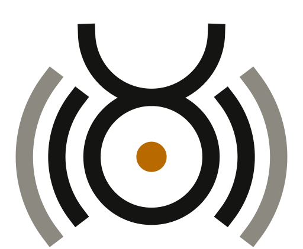

  <picture>
    <source media="(prefers-color-scheme: dark)" srcset="https://raw.githubusercontent.com/musithang/sdrtop/main/user_docs/pics/monas/monas-mark-on-dark-512.png">
    
  </picture>

<h1 align="center">monas-ft8</h1>

sdrtop's FT8 decoder.

This crate is part of [sdrtop](https://github.com/musithang/sdrtop), a
bench instrument for SDR hardware, and of `monasd`, its headless
counterpart. It is published only so that `cargo install sdrtop` and
`cargo install monasd` can build: crates.io will not install a program
whose libraries are not on it.

It has no stability promise of its own. Its version is sdrtop's, it
changes whenever sdrtop needs it to, and a version of it works with the
same version of the other `monas` crates and no other. If you want what is
in it, the source and the reasons for it are in the repository.
