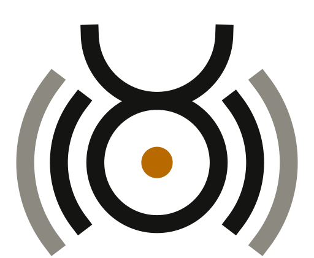

<p align="center">
  <picture>
    <source media="(prefers-color-scheme: dark)" srcset="https://raw.githubusercontent.com/musithang/sdrtop/main/user_docs/pics/monas/monas-mark-on-dark-512.png">
    
  </picture>
</p>

<h1 align="center">monasd</h1>

<p align="center"><b>The Monas engine with no screen: your radio and its measurements over HTTP and a WebSocket.</b></p>

monasd is [sdrtop](https://github.com/musithang/sdrtop) with the screen
taken off. Same engine, same radios, same config file. Instead of panels it
serves a small API, and it runs until something tells it to stop. Handy when
the radio is in the attic and you are not.

It opens the radio, computes the mode you ask for, takes commands and
streams events. It records SigMF, writes the CSV exports, can log the
2.4 GHz band unattended, and when the radio goes away it brings it back and
says how long it was gone. Every reading comes with when it was taken, or
with the reason it has none: never a bare zero.

## Install

```sh
curl -fsSL https://raw.githubusercontent.com/musithang/sdrtop/main/packaging/install.sh | sh -s -- --hackrf
```

puts sdrtop and monasd in, with your radio's runtime (`--rtlsdr`,
`--airspy`, `--airspyhf`, `--soapy` for the others). Or from crates.io:

```sh
cargo install monasd --locked
```

The radio's own library (libhackrf, librtlsdr, ...) is loaded at run time;
the installer flags above put it in.

## Run

```sh
monasd                                  # the one radio it finds, plain spectrum
curl -s http://127.0.0.1:7373/v1/health
```

It serves on `127.0.0.1:7373`. `Ctrl-C` stops it and writes the radio's
settings back to the config. Pick a radio, a mode or a frequency with flags:

```sh
monasd --device rtlsdr --frequency 433920000   # an RTL-SDR on 433.92 MHz
monasd --mode net_survey                       # the 2.4 GHz band survey
```

Listening beyond loopback needs a token; the guide says how.

## More

- [The monasd guide](https://github.com/musithang/sdrtop/blob/main/user_docs/monasd.md): modes, flags, the token, the config block, logging the band.
- [The API reference](https://github.com/musithang/sdrtop/blob/main/user_docs/api.md): every route, field, command and event, written from the code by a test.
- `monasd --help` and `man monasd`.

Linux, and unofficially macOS. GPL-3.0-or-later.
