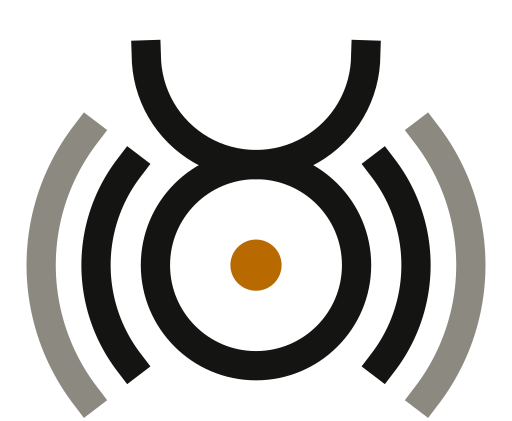
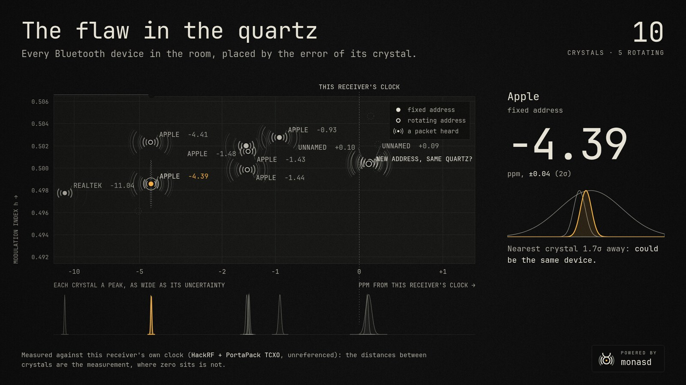

<p align="center">
  <picture>
    <source media="(prefers-color-scheme: dark)" srcset="../../user_docs/pics/monas/monas-mark-on-dark-512.png">
    
  </picture>
</p>

<h1 align="center">The flaw in the quartz</h1>

<p align="center">
  <b>Every Bluetooth device near you, placed by the error in its crystal.</b><br>
  <sub>Phones change their Bluetooth address to stay anonymous. Their quartz cannot change.</sub>
</p>

<p align="center">
  
</p>

## What you are looking at

Every Bluetooth LE device keeps time with a quartz crystal, and no two are
cut exactly alike. Each one transmits a little off frequency, by an amount
that is its own. The page places every device it hears by that error
(across, in parts per million) and by how far it swings its frequency for a
bit (up and down).

Phones change their address every few minutes so they cannot be followed.
When an old address goes quiet and a new one starts on the same spot, the
page draws a line: **NEW ADDRESS, SAME QUARTZ?** The question mark is
honest. How honest is in [METHOD.md](METHOD.md), with a number.

## Try it

You need a HackRF One with a 2.4 GHz antenna, and Python 3. Other radios
that reach 2.4 GHz and run Monas's Bluetooth views (a PlutoSky R2, a
PortaPack H4M in HackRF mode) should work too; I have only tried the HackRF.

1. **Get monasd**, 0.8.2 or newer: the
   [installer](../../README.md) with `--hackrf`, or from the root of this
   repository, `cargo install --locked --path crates/monasd`.
2. **Start it** on a copy of the config here (monasd writes its settings back
   when it stops, so give it a file of its own):

   ```sh
   cp config.toml ~/quartz.toml
   monasd --config ~/quartz.toml --device hackrf --mode net_census
   ```

3. **Start the page** in a second terminal, from this folder, and open
   <http://127.0.0.1:7380/>:

   ```sh
   python3 -I server.py 7380
   ```

The first dots appear within half a minute. Watch your own phone: put it
near the antenna and wait for its address to change.

**No dots?** Check the antenna is on, and that nothing else has the radio.
**No radio?** Open <http://127.0.0.1:7380/?fixture> instead: twenty minutes
of my flat, anonymised, played back (add `&speed=10` if you are impatient).

## Privacy

Addresses are masked at the source: monasd itself answers with "Apple #12",
not an address, and the page never draws a device's name or any part of its
address, only its maker. Nothing is stored and nothing is fetched from
anywhere else. Watch your own devices; your neighbours did not ask to be in
your screenshots.

## In this folder

| File | |
|---|---|
| `index.html`, `server.py`, `config.toml` | The page, the little server that joins it to monasd, the radio's settings |
| `METHOD.md` | How the numbers are made, the rule, and how often it would be wrong |
| `fixture.json` | Twenty minutes of a census, anonymised |
| `capture.py`, `anonymize.py` | How that was made, for your own |
| `chance.py` | The method's number, from any recording |
| `test/` | `node test/static.mjs` and `node test/replay.mjs index.html fixture.json`: PASS or FAIL |
