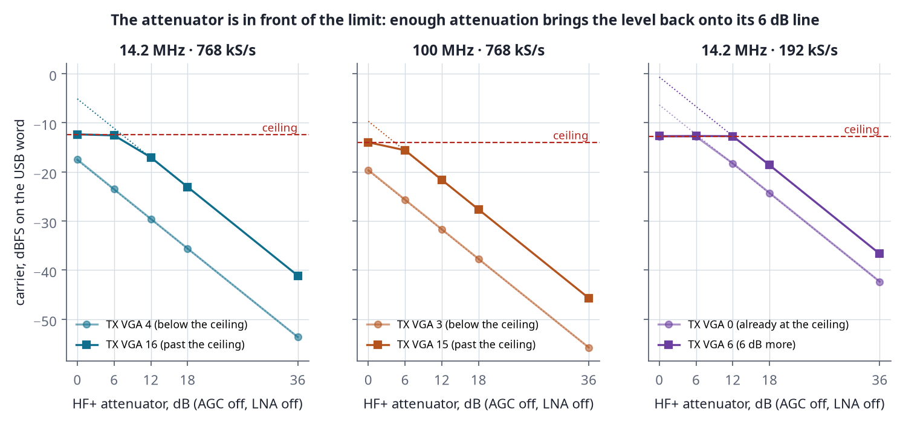
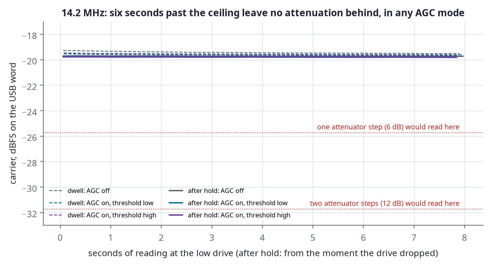

# Airspy HF+ Discovery, measured

← [Airspy HF+ Discovery](airspy-hf.md)

---

What sdrtop's bench found on one HF+ Discovery, in October 2026:

| | |
|---|---|
| Product | **Airspy HF+ Discovery**, made by [Airspy](https://airspy.com/) |
| Firmware | `R5.0.1-CD` |
| Library | libairspyhf 1.8.1 (git 24fe8ff), its DSP on |
| USB | `03eb:800c`, product name `AIRSPY HF+` |

Not covered by this page: the HF+ Dual Port or the Ranger, which answer on the
same id, the original HF+, or other firmware.

The signal source was a **HackRF One r10** (inside a PortaPack H4M, in HackRF
mode) on a short SMA cable into the antenna port, its amplifier off, no
attenuator. Every level here is in dBFS of the 16-bit USB word, the scale
sdrtop shows.

**Contents:** [The hold](#the-hold) · [Where it sits](#where-the-hold-sits) ·
[Clean, not clipped](#clean-not-clipped) · [Every rate](#one-hold-at-every-rate) ·
[The AGC switch](#the-agc-switch) · [ATT and LNA](#att-and-lna) ·
[Timing](#timing) · [Against SoapySDR](#against-the-generic-soapysdr-path) ·
[Not measured](#not-measured)

## The hold

Drive the HF+ harder and harder, and the level in the samples follows at 1 dB
per dB, then stops. Read through 48 dB of attenuation, the input keeps
rising: at the last step it is 29 dB past the point where the output stopped,
and 17 dB above what the USB word could carry.

Where it stops depends on what came before. A carrier that arrives well past
the hold is held lower; the next gain command sent while it is there lifts it,
even a command that changes nothing:

| Sample peak, dBFS | Arriving well past the hold | After a gain command |
|---|---|---|
| HF, 768 kS/s | -13.41 to -13.49 | -11.58 to -11.82 |
| HF, 192 kS/s | -13.22 to -13.33 | -11.52 to -11.56 |
| VHF, 768 kS/s | -14.69 to -14.83 | -13.30 to -13.62 |

Three repeats each, repeatable to 0.1 dB. A carrier only just past the hold
(about 2 dB) arrives at the upper figure. This is why sdrtop shows the hold
as a span, `HOLD -14 to -12 dBFS` on HF, and judges from its low edge.

## Where the hold sits

Below the hold the attenuator moves the carrier exactly: -17.52, -23.56,
-29.59, -35.62 and -53.66 dBFS at 0, 6, 12, 18 and 36 dB (14.2 MHz). Past
the hold, the first 6 dB still reads the hold, and from 12 dB on the level is
back on its 6 dB line. A limiter in front of the attenuator would let every
step show. **The hold is behind the attenuator**, in the digital stage that
Airspy calls the Digital IF AGC.

## Clean, not clipped

Most of what the slice shows besides the carrier is the HackRF's own spurs and
floor. Past the hold, with 12 dB more drive, all of it rises with the carrier
by the same 4.9 dB and keeps its distance to 0.3 dB (the right-hand traces lie
on each other). No new product appears. Clipping would add products; this is a
gain turned down, for everything in the slice at once.

## One hold at every rate

After a command, the sample peak stops at **-11.5 to -11.8 dBFS on HF and
-13.1 to -13.5 on VHF** at all seven rates. The hold acts on the word after the
firmware's filter gain, so on a narrow rate, where the same antenna signal
gives more word, it arrives with less signal: at 192 kS/s about 15 dB sooner
than at 768 kS/s.

## The AGC switch

Airspy says the switch turns on two analog AGCs ahead of the converter.
Nothing measured here showed them. Off, on at the low threshold and on at the
high one read within 0.3 dB of each other, at all seven rates in both bands,
below and past the hold.

Since the analog attenuator is said to move with hysteresis over seconds, it
was given time: each mode driven past the hold for six seconds, then the drive
dropped under the hold and read every 0.25 s for eight seconds.

| Drive held for 6 s | Past the hold | AGC off | AGC low | AGC high |
|---|---|---|---|---|
| VGA 18 | about 10 dB | -19.71 | -19.74 | -19.78 |
| VGA 24 | 16 dB | -19.30 | -19.35 | -19.39 |
| VGA 30 | about 23 dB | -19.48 | -19.51 | -19.53 |
| VGA 36 | 29 dB | -19.58 | -19.60 | -19.61 |

One 6 dB step left behind would read near -25.7. The switch did one visible
thing: with it on, the radio takes the attenuator over and a manual setting
stops applying. So sdrtop keeps the key, and has no threshold control.

## ATT and LNA

| | Measured |
|---|---|
| ATT, each 6 dB step | 6.01 to 6.04 dB |
| LNA | 6.0 dB (+5.85 to +6.08) |
| Both, against steady carriers | within 0.1 dB on VHF, 0.2 dB on HF |

Both are digital, after the converter: the LNA lifted the noise floor by the
same 6.0 dB as the signal. At full attenuation the radio's own noise is under
one step of the 16-bit word; rounded back to 16 bits, the library's
corrections lifted the floor by up to half a decibel. Carried in 32 bits the
difference measures under 0.001 dB.

## Timing

On the deliberately old i3:

| | Measured |
|---|---|
| Five minutes at 912 kS/s | 0 drops, 13 to 14 % CPU |
| Clock against the PC | -14 to +13 ppm from 30 s on |
| Jitter, zero-IF rates (912, 768) | ±1.1 to 1.9 ms |
| Jitter, low-IF rates | ±123 to 209 µs |
| Six rate changes | no wedge |

The reference: a broadcast carrier at 9.6 MHz sat 10.9 Hz low (-1.14 ppm) from
every tuning, which is the radio's reference or the broadcaster's; a carrier
known to be exact would tell.

## Against the generic SoapySDR path

There is no comparison to make. SoapyAirspyHF delivers floats, and sdrtop's
pipeline is integer, so through SoapySDR the HF+ did not work in sdrtop at
all.

## Not measured

- **The AGCs' attack and release times.**
- **The radio's own noise floor:** the HackRF's floor covers it.
- **Absolute levels:** the HackRF's output was not calibrated, so drives are
  given as its settings, and levels as the HF+ read them.

---

← [Airspy HF+ Discovery](airspy-hf.md)
