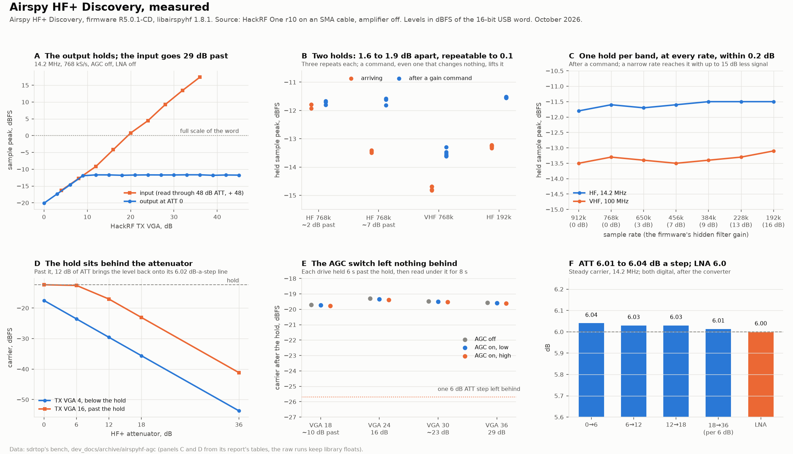
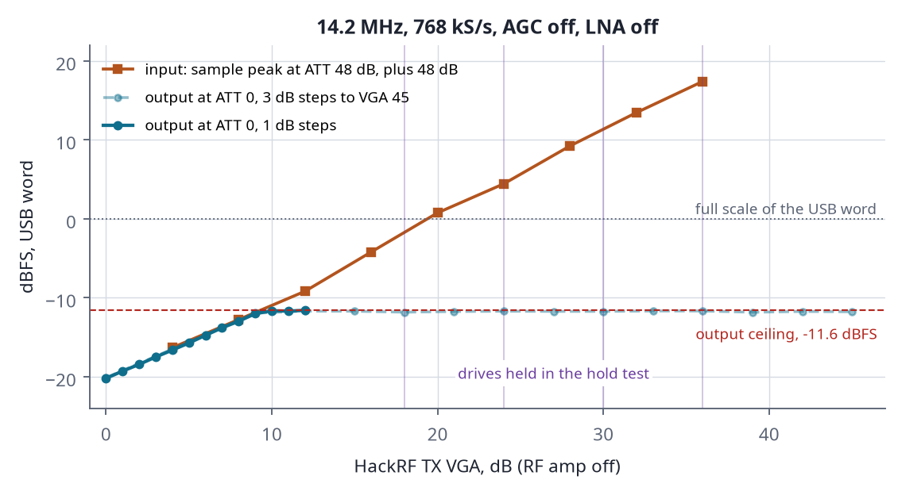
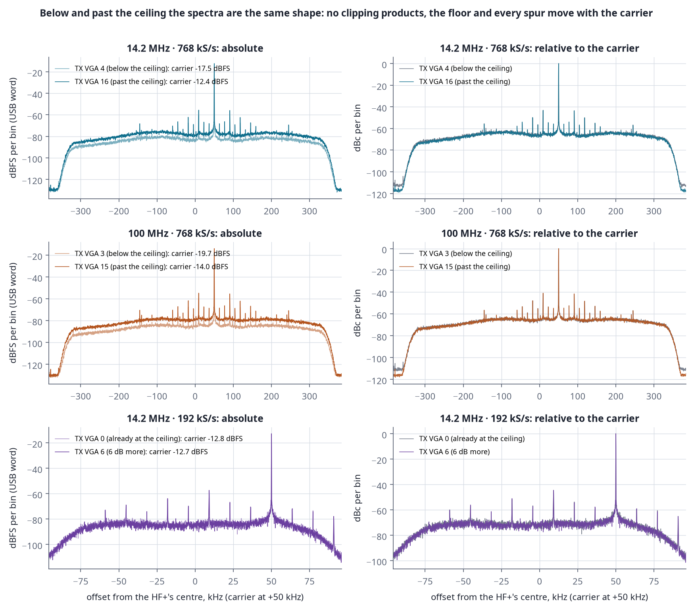
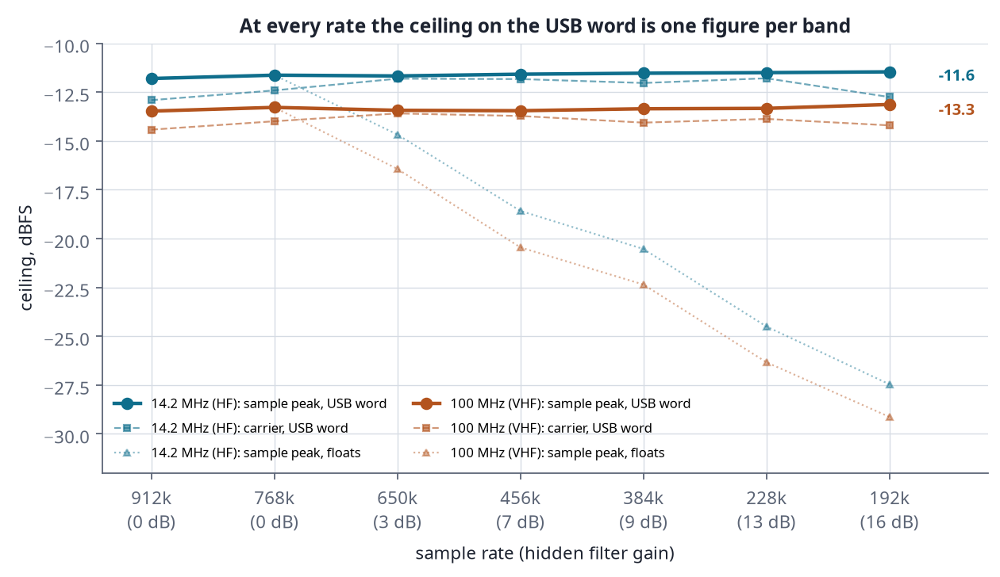

# Airspy HF+ Discovery, measured

← [Airspy HF+ Discovery](airspy-hf.md)

---

This is what I measured on my HF+ Discovery in October 2026:

| | |
|---|---|
| Radio | Airspy HF+ Discovery, made by [Airspy](https://airspy.com/) |
| Firmware | `R5.0.1-CD` |
| Library | libairspyhf 1.8.1 (git 24fe8ff), its DSP on |
| USB | `03eb:800c`, named `AIRSPY HF+` |

The HF+ Dual Port and the Ranger answer on the same USB id, but this page
isn't about them, nor about the original HF+ or other firmware.

The signal came from a HackRF One r10 (inside a PortaPack H4M, in HackRF mode)
on a short SMA cable straight into the antenna port, its amplifier off, with
no attenuator in between. Every level here is in dBFS of the 16-bit USB word,
the same scale sdrtop shows.

**Contents:** [The hold](#the-hold) · [Where it sits](#where-the-hold-sits) ·
[Clean, not clipped](#clean-not-clipped) · [Every rate](#one-hold-at-every-rate) ·
[The AGC switch](#the-agc-switch) · [ATT and LNA](#att-and-lna) ·
[Timing](#timing) · [Against SoapySDR](#against-the-generic-soapysdr-path) ·
[Not measured](#not-measured)

## The hold

Drive the HF+ harder and harder, and the level in the samples follows the
signal dB for dB, then stops. I read the input through 48 dB of attenuation
at the same time, and it kept rising: by the last step it was 29 dB past the
point where the output stopped, and 17 dB more than the USB word could even
carry.

Where exactly it stops depends on what happened before. A carrier that arrives
well past the hold is held lower. Send the radio any gain command while the
carrier is there, even one that changes nothing, and the hold moves up:

| Sample peak, dBFS | Arriving well past the hold | After a gain command |
|---|---|---|
| HF, 768 kS/s | -13.41 to -13.49 | -11.58 to -11.82 |
| HF, 192 kS/s | -13.22 to -13.33 | -11.52 to -11.56 |
| VHF, 768 kS/s | -14.69 to -14.83 | -13.30 to -13.62 |

Three runs each, and they repeat to a tenth of a dB. A carrier only about 2 dB
past the hold arrives at the upper figure straight away. That's why sdrtop
shows the hold as a range, `HOLD -14 to -12 dBFS` on HF, and starts worrying
at its lower edge.

## Where the hold sits

Below the hold, the attenuator moves the carrier exactly: -17.52, -23.56,
-29.59, -35.62 and -53.66 dBFS at 0, 6, 12, 18 and 36 dB (14.2 MHz). Past the
hold, the first 6 dB of attenuation still reads the hold, and from 12 dB on
the level is back on its 6 dB line. If the limiter sat in front of the
attenuator, every step would have shown. So the hold comes after the
attenuator, in the digital stage Airspy calls the Digital IF AGC.

## Clean, not clipped

Most of what you see around the carrier is the HackRF's own spurs and noise.
That makes it a handy probe. Past the hold, with 12 dB more drive, all of it
rises with the carrier by the same 4.9 dB, and keeps its distance from it to
0.3 dB (on the right the two traces lie on top of each other). Nothing new
shows up. Clipping would have added products. This is the gain being turned
down, for everything in view at once.

## One hold at every rate

After a command, the sample peak stops at -11.5 to -11.8 dBFS on HF and -13.1
to -13.5 on VHF, at all seven rates. The hold works on the word after the
firmware's filter gain. On a narrow rate the same antenna signal makes a
bigger word, so the hold arrives sooner: at 192 kS/s with about 15 dB less
signal than at 768.

## The AGC switch

Airspy says the AGC switch turns on two analog AGCs in front of the converter.
I couldn't see either of them do anything. Off, on at the low threshold and on
at the high one all read within 0.3 dB of each other, at all seven rates, in
both bands, below the hold and past it.

The analog attenuator is said to move slowly, over seconds, so I gave it time,
and then more time than is probably healthy.
In each mode I drove the radio past the hold for six seconds, then dropped
the drive below the hold and read the carrier four times a second for eight
seconds.

| Drive held for 6 s | Past the hold | AGC off | AGC low | AGC high |
|---|---|---|---|---|
| VGA 18 | about 10 dB | -19.71 | -19.74 | -19.78 |
| VGA 24 | 16 dB | -19.30 | -19.35 | -19.39 |
| VGA 30 | about 23 dB | -19.48 | -19.51 | -19.53 |
| VGA 36 | 29 dB | -19.58 | -19.60 | -19.61 |

One 6 dB attenuator step left behind would have read around -25.7. The switch
did do one thing I could see: with it on, the radio takes the attenuator over,
and a manual setting stops working. So sdrtop keeps the key, and leaves out
the threshold control, because it made no difference I could measure.

## ATT and LNA

| | Measured |
|---|---|
| ATT, each 6 dB step | 6.01 to 6.04 dB |
| LNA | 6.0 dB (+5.85 to +6.08) |
| Both, on steady carriers | within 0.1 dB on VHF, 0.2 dB on HF |

Both are digital and come after the converter. Switching the LNA on lifted the
noise floor by the same 6 dB as the signal. With the attenuator all the way
up, the radio's own noise is less than one step of the 16-bit word, and
rounding the library's corrections back to 16 bits lifted the floor by up to
half a dB. Carried in 32 bits, the difference was under 0.001 dB.

## Timing

On the deliberately old i3:

| | Measured |
|---|---|
| Five minutes at 912 kS/s | nothing lost, 13 to 14 % CPU |
| Clock against the PC | -14 to +13 ppm, after the first 30 s |
| Jitter at 912 and 768 kS/s | ±1.1 to 1.9 ms |
| Jitter at the other rates | ±123 to 209 µs |
| Six rate changes | it never got stuck |

A broadcast carrier at 9.6 MHz came out 10.9 Hz low (-1.14 ppm), the same from
every tuning. That's either the radio's reference or the broadcaster's. A
carrier I knew to be exact would tell which.

## Against the generic SoapySDR path

There's nothing to compare. SoapyAirspyHF hands over floats, sdrtop works in
integers, and through SoapySDR the HF+ never worked in sdrtop at all.

## Not measured

- **How fast the AGCs react and let go.**
- **The radio's own noise floor.** The HackRF's floor covers it.
- **Absolute levels.** The HackRF isn't calibrated, so drives are given as its
  settings and levels as the HF+ read them.

---

← [Airspy HF+ Discovery](airspy-hf.md)
