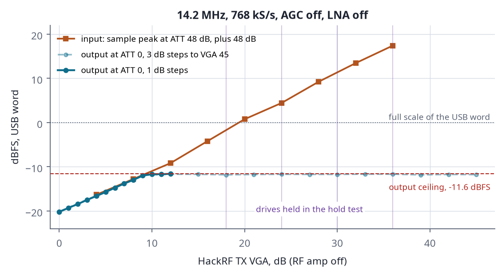

# Airspy HF+ Discovery

← [Supported hardware](hardware.md)

---

Of all the radios on my desk, this is the one I enjoyed working on most. And
on HF it is probably the best receiver I have used. Not because of a number on
a datasheet, but because of how little it asks of you.

Most SDRs hand you a gain chain and wish you luck. Set the gain too low and the
weak signals drown, too high and the first strong station clips the converter.
The HF+ Discovery is built the other way round. It manages its own levels,
inside the radio, all the time, and what reaches the USB cable has already
been scaled to fit. On HF, where a big broadcaster a few hundred kHz away is
perfectly normal, that is the difference between a receiver you babysit and
one you just use.

It also changes what half the numbers on a bench mean, which is why it gets a
page of its own, and a careful one. What I measured on it, with the charts, is
on **[Airspy HF+ Discovery, measured](airspy-hf-measured.md)**.

**Contents:** [At a glance](#at-a-glance) ·
[Not a classic gain chain](#not-a-classic-gain-chain) · [The hold](#the-hold) ·
[How hard it can be pushed](#how-hard-it-can-be-pushed) ·
[Two bands and a gap](#two-bands-and-a-gap) ·
[Rates](#rates-and-what-0-dbfs-means) ·
[The LO](#the-lo-and-the-library-dsp-switch) · [Timing](#timing) ·
[Other HF+ boards](#observer-mode-and-the-other-hf-boards) ·
[Installing the library](#installing-the-library)

## At a glance

| | |
|---|---|
| Bands | 9 kHz to 31 MHz, and 60 to 260 MHz |
| Sample rates | 912, 768, 650, 456, 384, 228, 192 kS/s |
| Samples | The radio's 16-bit word, carried in 32 bits with 8 bits below it |
| Gain controls | ATT (0 to 48 dB, 6 dB steps) and LNA (off or +6 dB), both digital, after the converter |
| Level control | The radio's own AGCs, always working; the `a` key hands them the ATT too |
| Ceiling | None that clips: the radio holds peaks at about −12 dBFS |
| LO | 5 kHz above the centre at 912 and 768 kS/s, at the centre at the others |
| Library | libairspyhf 1.6.8 or newer (rehearsed on 1.8.1), firmware `R5.0.1-CD` |
| Bias tee | None on the Discovery |

Before this backend the HF+ didn't work in sdrtop at all. Its SoapySDR driver
delivers floats (`CF32`), and sdrtop's pipeline is integer. Now a plain
`sdrtop` opens it natively.

## Not a classic gain chain

The radio runs automatic gain control in its RF, IF and digital stages, and
all three loops are always at work. When the analog stages back off for a
strong signal, the digital gain makes up the difference, so the level in the
samples stays where it was, to a fraction of a dB. You never see the radio
protecting itself. You only notice that nothing clipped.

The controls keep the names every HF+ program uses, **ATT** and **LNA**, but
neither is quite what its name suggests. Both are digital gain, applied after
the converter. ATT turns the digital stage down in 6 dB steps, and the LNA adds
one more 6 dB step. They decide where the signal sits in the 16-bit word. They
don't decide the signal-to-noise ratio; that was settled before them. And both
are exact: every ATT step measured between 6.01 and 6.04 dB, the LNA 6.0.

ATT also works ahead of the hold described below. While the digital AGC is
holding a strong signal, more ATT brings it back under the hold, onto its line
again, where its level is the antenna's.

So sdrtop draws the radio as it is:

- The chain reads `ANT▸AGC▸ADC▸ATT▸LNA▸word`. The gain lineup starts at the
  converter, and the level diagram walks the samples back through the digital
  gain, not out to the antenna.
- The RF bench talks about placement: `LEVEL WELL PLACED`,
  `LEVEL LOW IN THE WORD`, `LEVEL HOT`, `LEVEL HELD`. It never promises a better
  signal for more LNA, and the footer says `SNR set in the radio`.
- The noise sweep (`[K]`) is refused. Gain that moves the floor as far as the
  signal leaves no front end to measure.
- The converter bench is called **Word Loading**, since what it reads is the
  USB word. The radio's own converter is never visible from outside.
- There's no noise figure card. There are no per-stage figures to compute one
  from.

The keys: `↑` `↓` move ATT, `[` `]` switch the LNA. sdrtop starts with ATT at 0
and the LNA off, on the first run and on `[R]`. On any antenna whose band noise
is above the radio's own, which on HF is nearly every antenna, the LNA only
lifts everything together and costs you 6 dB of headroom.

### The `a` key

`a` switches the radio's AGC setting, saved per radio like every other boost.
What it visibly does is hand the attenuator to the radio. ATT reads `AGC`, a
manual setting stops applying, and the LNA stays yours. The radio doesn't
report the attenuation it picks, so sdrtop doesn't show one. The radio's AGC
loops keep working either way, and the log says so: `AGC ON: the radio sets
ATT; its AGCs are always on`. There's no threshold control. On a cable, low and
high measured the same, so sdrtop leaves it at low.

## The hold

Push a strong signal in and its peak stops rising at about −12 dBFS, cleanly,
with no clipping and nothing new in the spectrum. That's the digital AGC
turning the radio's own gain down, early enough to leave the word some room for
transients.

Where exactly it stops depends on what came before. A carrier that arrives
well past the hold is held about 2 dB lower (−13.5 on HF, −14.8 on VHF). The
next gain command sent while it's there lifts it to −11.6 and −13.3, even a
command that changes nothing. That's the AGC's hysteresis, and a command starts
it afresh. sdrtop only sends a command when you press a key, so the lower
figure is the one you'll usually see.

So sdrtop shows the hold as a range, `HOLD -14 to -12 dBFS (digital AGC)` on
HF, and judges from its lower edge. Past it, the level in the samples may no
longer be the antenna's. A peak there reads `HELD`, not `CLIPPING`, because
nothing was lost. Auto-gain (`A`) from a held peak goes to full attenuation
first, since there's no telling how far past the hold the signal is, and the
next `A` lands it. For a strong signal that is what this radio was built for
anyway: more ATT, LNA off, and the signal sits comfortably inside the radio's
numeric range, where it can't overload by construction.

## How hard it can be pushed

Far harder than the USB word can carry. On a cable I drove it 29 dB past the
hold for six seconds, and the output stayed at the hold, clean, with no
attenuation left behind afterwards. I was more nervous about it than the radio
was. Whatever it protects itself with is invisible from outside, which is the
whole point.

The other end is just as quiet. With the attenuator all the way up, the
radio's own noise is less than one step of the 16-bit word, so sdrtop carries
the samples in 32 bits, 8 of them below the word, where rounding can't lift the
floor. Recordings of the HF+ are `ci32_le` for the same reason
([the SigMF extension](sdrtop.sigmf-ext.md)).

## Two bands and a gap

The radio accepts any frequency and shows a flat floor where it doesn't
receive, so the bands are Airspy's published ones. A frequency typed into the
gap is refused, with both bands named. `←` and `→` stop at a band's edge
instead of jumping 29 MHz; type the frequency to cross. The header's dial caps
each band's edge and names the gap between them (`╡ 31–60M ╞`), the menu's
ruler draws it dotted, and a sweep across it leaves a hole rather than tuning
where nothing is received. Bluetooth and Wi-Fi are refused: 2.4 GHz is about
nine times higher than this radio goes, and no amount of optimism changes that.

## Rates, and what 0 dBFS means

sdrtop starts on 768 kS/s at 7.100 MHz, because somewhere on 40 m there is
always something. `s` lists the seven rates, and `←` `→` step through them.

**0 dBFS is the 16-bit USB word**, where the samples really clip. The firmware
filters each rate with its own gain, so a carrier's dBFS changes with the rate
by that much:

| Rate (kS/s) | 912 | 768 | 650 | 456 | 384 | 228 | 192 |
|---|---|---|---|---|---|---|---|
| Filter gain (dB) | 0 | 0 | 3 | 7 | 9 | 13 | 16 |

The library doesn't publish this figure, so sdrtop reads it from the samples
at the start of every stream. The first block comes with the library's
corrections off, where every sample is a whole word times that gain, so the
gain comes out exact. That block isn't shown, the log says what was read, and
on another firmware it is read the same way rather than assumed.

**A rate change stops the stream first.** On this firmware, switching to a
low-IF rate while streaming and then tuning near 9 kHz can leave the radio
unable to stream again until it's unplugged. Airspy looked into it and traced
it to the silicon. Changing the rate with the stream stopped never triggers it,
so sdrtop always does it that way.

## The LO, and the Library DSP switch

The firmware tunes in whole kHz, and libairspyhf adds the rest by default. It
fine-tunes to the hertz, and at the two zero-IF rates (912 and 768 kS/s) it
balances I and Q and puts the LO **5 kHz above** the frequency you asked for,
so the LO's DC leak sits off to the side instead of on top of your signal.

sdrtop follows the LO wherever it is. The I/Q bench reads the leak at
`+5.0 kHz`, the image scope mirrors about the LO, and the demodulator warns
about the LO's leak. At those two rates the I/Q balance is **not judged**: the
samples have been moved off the LO and already balanced, so their balance says
nothing about the hardware. The bench says so, and `[C]` declines to
calibrate. At the low-IF rates the LO is the centre, and the balance is
measured as usual.

The menu's **Options** pane has a **Library DSP** switch, on by default. Off,
the samples arrive exactly as the radio sent them, the radio sits on the kHz
grid, and the header shows the frequency it really has. Ask for 7.0743 MHz and
it reads 7.074 MHz, with `tuned to 7.074000 MHz, -300 Hz` in the log. Below
180 kHz it can't be tuned with the switch off, so there it is refused. Saved as
`[airspyhf] dsp`.

## Timing

libairspyhf delivers on its own thread, eight blocks deep, 4096 sample pairs a
block with 1.8.1 (2048 with 1.6.8), and sdrtop reads the size at open. Jitter
is larger at the zero-IF rates, about ±1.5 ms, because the library balances I
and Q on its delivery thread; at the others it's about ±0.2 ms. `link util`
reads against this radio's own top rate, so 768 kS/s shows about 84 %. That's
correct, not a warning.

## Observer mode, and the other HF+ boards

In [observer mode](advanced.md#observer-mode-when-another-app-owns-the-radio)
the radio is found on USB as `03eb:800c` with the product name `AIRSPY HF+`.
That vendor id is Atmel's and turns up on boards that aren't radios at all
(a microcontroller dev board makes a wonderfully quiet receiver), so the name
has to match too. sdrtop names the program holding it.

The **HF+ Dual Port** and the **Ranger** answer on the same id and the same
library. sdrtop tells them apart by the part id their firmware reports, names
them, and doesn't drive them. I've never held one, and their attenuators,
front ends and rates would be guesses. Through SoapySDR they meet the same
`CF32` refusal.

## Installing the library

`sh install.sh --airspyhf`, or your distribution's package from
[Getting started](getting-started.md#what-you-need).

The Airspy HF+ Discovery needs libairspyhf 1.6.8 or newer (1.8.1 is what it
was rehearsed with). Linux candidates are `libairspyhf.so.0`,
`libairspyhf.so.1` (Debian and Ubuntu rename it) and `libairspyhf.so`. Runtime
packages include `libairspyhf1` on Debian and Ubuntu and `airspyhf` on Fedora,
openSUSE and Homebrew. Arch has no official package, only the AUR's
`airspyhf-git`. Ubuntu 20.04's 1.1.5 is too old and is refused whole.

---

← [Supported hardware](hardware.md)
