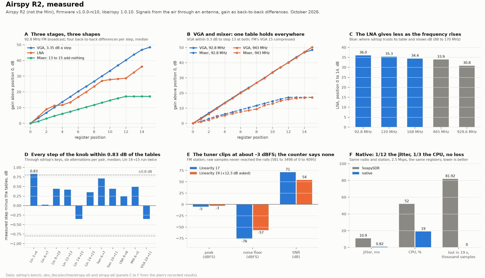
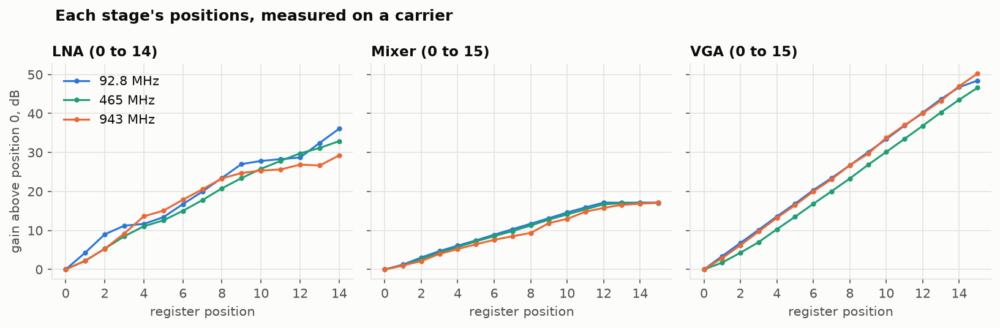

# Airspy R2, measured

← [Airspy R2](airspy-r2.md)

---

What sdrtop's bench found on one Airspy R2, in October 2026:

| | |
|---|---|
| Product | **Airspy R2**, made by [Airspy](https://airspy.com/) |
| Firmware | `v1.0.0-rc10-0-g946184a` (2016) |
| Library | libairspy 1.0.10 |
| Tuner | Rafael Micro R820T family, its LNA, mixer and VGA; a 12-bit converter |
| USB | `1d50:60a1`, product name `AIRSPY` |

Not covered by this page: the Airspy Mini, which answers on the same id, or
other firmware.
 The signals came from the air, through an antenna:
an FM broadcast at 92.8 MHz, steady carriers at 120, 168, 465 and 928.6 MHz,
GSM at 943.4 MHz. Broadcasts sway by several dB over minutes, so every gain
figure is a back-to-back difference (a step down and up again, four times,
the median), which cancels the drift: on FM the four differences agree within
0.02 to 0.1 dB. Steps with under 15 dB of signal-to-noise were left out. Other
units, and other firmware, may differ.

**Contents:** [The three stages](#the-three-stages) ·
[The LNA and frequency](#the-lna-and-frequency) ·
[The knob, checked](#the-knob-checked) · [The ceiling](#the-ceiling) ·
[Timing](#timing) · [Against SoapySDR](#against-the-generic-soapysdr-path) ·
[Not measured](#not-measured)

## The three stages

libairspy takes register positions and says nothing about decibels, so each
position was measured.

| Stage | Positions | Measured |
|---|---|---|
| VGA | 0 to 15 | 3.35 dB a step, 50 dB in all, the same at every frequency within 0.3 dB |
| Mixer | 0 to 15 | about 1.4 dB a step to 12, 16 dB in all; **13 to 15 add nothing** |
| LNA | 0 to 14 | 36 dB at 92.8 MHz, less higher up, and in a different shape |

The tuner's own AGC must be switched off at open: left to the firmware's
default, the same step scattered by up to 5 dB from one open to the next.
With it off, a level repeats within ±0.1 dB.

## The LNA and frequency

Between 92.8 and 120 MHz the LNA's steps agree within 0.1 to 0.8 dB. Higher up
the total falls and the steps change shape (at 943 MHz step 13 adds nothing).
One table would be several dB wrong somewhere, so sdrtop shows the LNA in dB
from 88 to 170 MHz only, and as a position elsewhere.

## The knob, checked

The gain stepped through sdrtop's own keys, each step against the one before,
six times back and forth, read on the Signal bench:

Every step within 0.83 dB of the tables, on average 0.35 dB over: inside what
a fading broadcast carrier can resolve. Over the whole Linearity curve (a 52 dB
span), the carrier minus the gain on screen had no trend: -0.005 dB per dB.

## The ceiling

On the FM carrier, two steps of Linearity (17 to 19) should have added
12.3 dB. The peak went from -5 to -3 dBFS, the floor rose 19 dB, and the ADC
bench said `clip none`. With the VGA alone turned down 20 dB, the signal was
clean again: the front end was not what overloaded.

Raw converter samples at Linearity 17, 19 and 21 never touched the rails (0
and 4095; they stayed within about 581 and 3498). The peak held at -2.9 dBFS
while the rms climbed to meet it, the crest factor falling from 2.2 to 0.6 dB:
a waveform squared off in the tuner's IF output, before the converter. So on
an R2 the usable top is about **-3 dBFS**, and a clip counter cannot see it.
The tuner's AGC, on that same station, parked the signal right there.

## Timing

| | Measured |
|---|---|
| 2.5 Msps | jitter ±1.0 ms, 0 drops |
| 10 Msps, five minutes | jitter ±0.8 ms (p99 2.0 ms), 41 % CPU on the i3, 38.1 MB/s, 0 USB errors |
| Rate changes while streaming | clean restarts, nothing lost |
| About 17 minutes at 10 Msps | one burst of about 0.4 s lost, near a system-wide pause; none in the 10 minutes watched after |

That one burst is why the timing bench now says whose a loss was:
libairspy's queue or sdrtop's.

## Against the generic SoapySDR path

The same radio, same station, 2.5 Msps, registers LNA 0 · mixer 15 · VGA 15:

| | SoapySDR | Native |
|---|---|---|
| Gain on screen | `MIX +15 dB · VGA +15 dB`: positions read as dB; the LNA a switch | `LNA +0 · MIX +16 · VGA +49 dB`, measured |
| Converter | read against 16 bits | read against its 12 bits |
| Jitter | ±10.9 ms | ±0.82 ms |
| Lost | 81,920 samples in the first 19 s | none |
| CPU | 52 % | 19 % |
| SNR, FM | 55 dB | 56 dB |

Back to back on the same registers minutes apart, the DC spike and the image
read the same on both paths (image about 47 dB down): the radio is the same
radio either way.

## Not measured

- **The LNA outside 88 to 170 MHz in full:** the air gave too little signal or
  too much sway; a cable and a steady source would settle it.
- **A Mini, or another firmware.**
- **Absolute levels:** nothing calibrated was at hand.

---

← [Airspy R2](airspy-r2.md)
