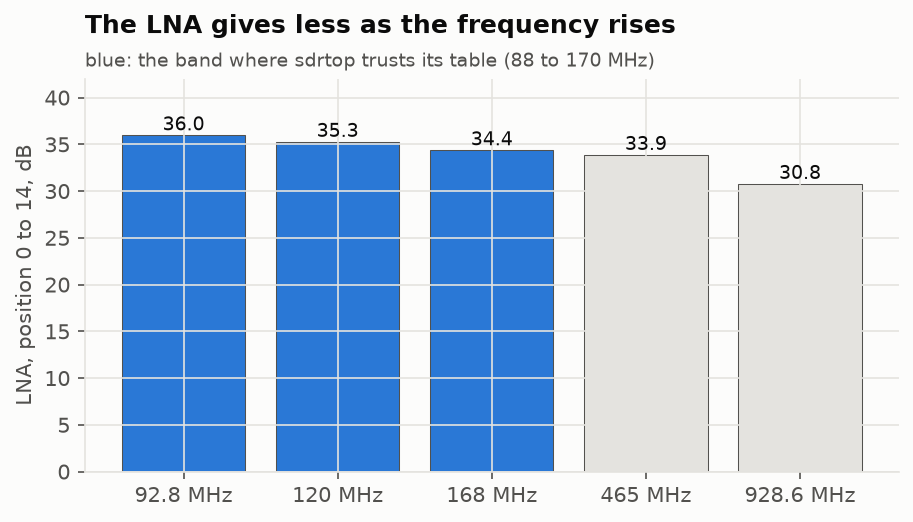
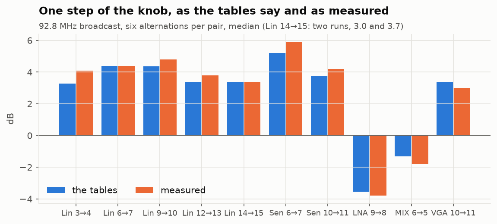

# Airspy R2, measured

← [Airspy R2](airspy-r2.md)

---

This is what I measured on my Airspy R2 in October 2026:

| | |
|---|---|
| Radio | Airspy R2, made by [Airspy](https://airspy.com/) |
| Firmware | `v1.0.0-rc10-0-g946184a` (2016) |
| Library | libairspy 1.0.10 |
| Tuner | Rafael Micro R820T family (LNA, mixer, VGA), 12-bit converter |
| USB | `1d50:60a1`, named `AIRSPY` |

The Airspy Mini answers on the same USB id, but this page isn't about it, nor
about other firmware.

I didn't have a cable for this radio yet, so the signal generator was whatever
the neighbourhood was broadcasting, working unpaid and unaware. The signals
came off the air, through an antenna: an FM station at 92.8 MHz,
steady carriers at 120, 168, 465 and 928.6 MHz, and GSM at 943.4 MHz.
Broadcasts drift by several dB over minutes, so every gain figure is a
difference taken back to back: a step down and up again, four times, and the
median of those. The drift cancels out, and on FM the four differences agreed
within 0.02 to 0.1 dB. Steps with under 15 dB of signal-to-noise I left out.

**Contents:** [The three stages](#the-three-stages) ·
[The LNA and frequency](#the-lna-and-frequency) ·
[The knob, checked](#the-knob-checked) · [The ceiling](#the-ceiling) ·
[Timing](#timing) · [Against SoapySDR](#against-the-generic-soapysdr-path) ·
[Not measured](#not-measured)

## The three stages

libairspy takes register positions and says nothing about decibels, so I
measured every position.

| Stage | Positions | Measured |
|---|---|---|
| VGA | 0 to 15 | 3.35 dB a step, 50 dB in all, the same at every frequency within 0.3 dB |
| Mixer | 0 to 15 | about 1.4 dB a step up to 12, 16 dB in all; 13 to 15 add nothing |
| LNA | 0 to 14 | 36 dB at 92.8 MHz, less higher up, and shaped differently |

The tuner's own AGC has to be switched off when the radio opens. Left to the
firmware's default, the same step came out up to 5 dB different from one
opening to the next. With it off, a level repeats within ±0.1 dB.

## The LNA and frequency

At 92.8 and 120 MHz the LNA's steps agree within 0.1 to 0.8 dB. Higher up the
total drops and the steps change shape; at 943 MHz step 13 adds nothing. One
table would be several dB off somewhere, so sdrtop shows the LNA in dB only
from 88 to 170 MHz, and as a plain position everywhere else.

## The knob, checked

I stepped the gain with sdrtop's own keys, each step against the one before,
six times back and forth, and read the level on the Signal bench:

Every step came within 0.83 dB of the tables, about 0.35 dB over them on
average. That's as fine as a fading broadcast lets you look. Over the whole
Linearity curve, 52 dB of it, the carrier minus the gain on screen didn't
trend anywhere: -0.005 dB per dB.

## The ceiling

On the FM station, going from Linearity 17 to 19 should have added 12.3 dB.
The peak went from -5 to -3 dBFS, the floor came up 19 dB, and the ADC bench
said `clip none`. With only the VGA turned down by 20 dB, the signal was clean
again, so the front end wasn't the part overloading.

The raw converter samples at Linearity 17, 19 and 21 never touched the rails
(they stayed between about 581 and 3498, out of 0 to 4095). The peak held at
-2.9 dBFS while the rms climbed up to meet it, the crest factor falling from
2.2 to 0.6 dB. The waveform was being squared off in the tuner's IF output,
before the converter ever saw it. On an R2 the usable top is about -3 dBFS,
and a clip counter can't see it. On that same station the tuner's AGC parked
the signal right there.

## Timing

| | Measured |
|---|---|
| 2.5 Msps | jitter ±1.0 ms, nothing lost |
| 10 Msps, five minutes | jitter ±0.8 ms (p99 2.0 ms), 41 % CPU on the i3, 38.1 MB/s, no USB errors |
| Rate changes while streaming | clean restarts, nothing lost |
| About 17 minutes at 10 Msps | one burst of about 0.4 s lost, near a pause of the whole machine; none in the ten minutes I watched after |

That one burst is why the timing bench now tells you whose loss it was,
libairspy's queue or sdrtop's.

## Against the generic SoapySDR path

The same radio on the same station at 2.5 Msps, with the same registers (LNA
0, mixer 15, VGA 15):

| | SoapySDR | Native |
|---|---|---|
| Gain on screen | `MIX +15 dB · VGA +15 dB`, positions read as dB, and the LNA as a switch | `LNA +0 · MIX +16 · VGA +49 dB`, measured |
| Converter | read against 16 bits | read against its own 12 |
| Jitter | ±10.9 ms | ±0.82 ms |
| Lost | 81,920 samples in the first 19 s | none |
| CPU | 52 % | 19 % |
| SNR on FM | 55 dB | 56 dB |

Measured back to back on the same registers, minutes apart, the DC spike and
the image (about 47 dB down) were the same on both paths. It's the same radio
either way. The difference is in how it's driven.

## Not measured

- **The LNA outside 88 to 170 MHz, in full.** The air gave too little signal or
  too much drift. A cable and a steady source would settle it.
- **A Mini, or other firmware.**
- **Absolute levels.** Nothing calibrated was at hand.

---

← [Airspy R2](airspy-r2.md)
