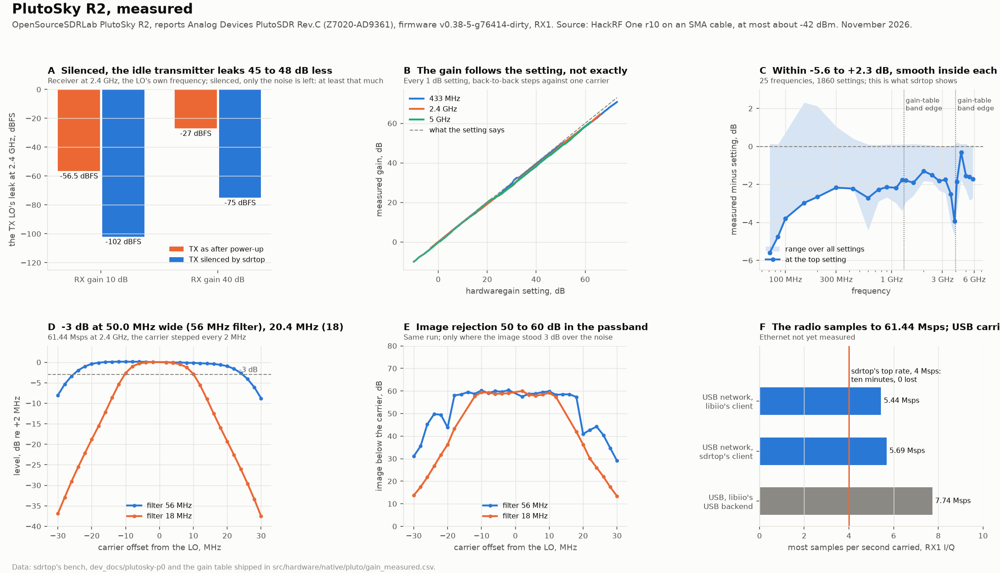
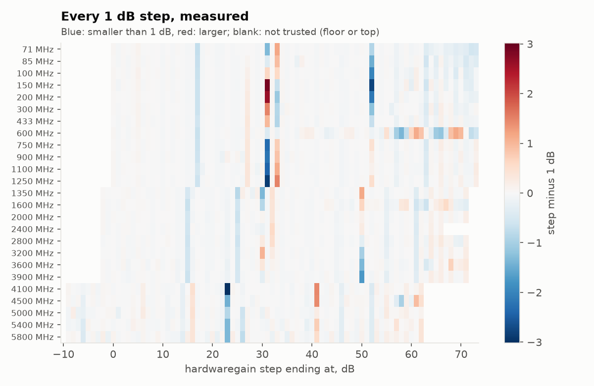
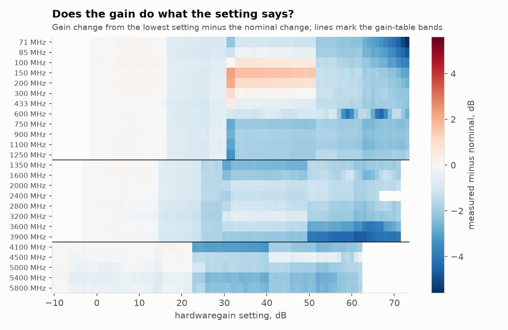
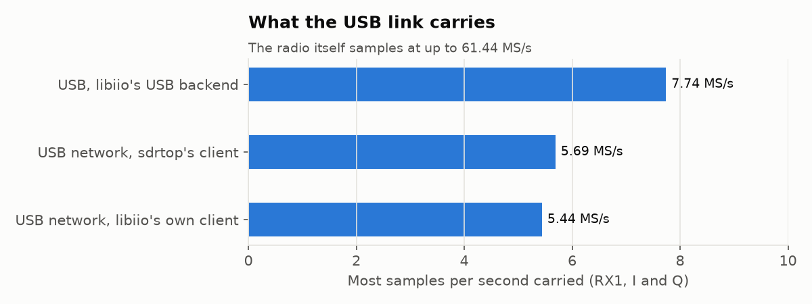

# PlutoSky R2, measured

← [PlutoSky R2](plutosky-r2.md)

---

What sdrtop's bench found on one PlutoSky R2, in November 2026. The PlutoSDR
family has many boards, and they differ, so here is exactly which one:

| | |
|---|---|
| Product | **PlutoSky R2**, made by [OpenSourceSDRLab](https://opensourcesdrlab.com/) |
| It reports itself as | `Analog Devices PlutoSDR Rev.C (Z7020-AD9361)`, model variant 1 |
| Firmware | `v0.38-5-g76414-dirty` (OpenSourceSDRLab's build of v0.38), Linux 5.15.0, iiod 0.25 |
| Chips | Xilinx Zynq 7020 and an RF transceiver that reports itself as AD9361 |
| AD9361, not AD9363? | It behaves as an AD9361 where the two differ: full gain and image rejection at 71 MHz and 5.8 GHz (outside the AD9363's 325 to 3800 MHz), a 50 MHz passband (the AD9363's is 20). Consistent, not proof: the two are one die, sorted |
| USB | `0456:b673`, the id every PlutoSDR shares, over its USB network |
| Port measured | RX1 |

Not measured here, and not covered by this page: the ADALM-PLUTO, the Pluto+,
other OpenSourceSDRLab boards, or this board on other firmware.

The signal source was a **HackRF One r10** (inside a PortaPack H4M, in HackRF
mode) on an SMA cable into RX1, at most about -42 dBm, far under the AD9361's
+2.5 dBm limit.

**Contents:** [The idle transmitter](#the-idle-transmitter) ·
[Gain](#gain) · [Filter and image](#filter-and-image) ·
[The link](#the-link) · [Timing](#timing) ·
[Against SoapySDR](#against-the-generic-soapysdr-path) ·
[Not measured](#not-measured)

## The idle transmitter

An AD9361 receives and transmits at once. After power-up the R2's transmitter
sends nothing, but its LO keeps running, and an LO leaks.

| RX gain | Transmitter as after power-up | Transmitter silenced |
|---|---|---|
| 10 dB | -56.5 dBFS | about -102 dBFS (the noise) |
| 40 dB | -27.0 dBFS | about -75 dBFS (the noise) |

With the receiver tuned to the same 2.4 GHz, the leak lands at 0 Hz and fills
the converter. This is why sdrtop powers the transmitter down when it opens
the radio ([how](plutosky-r2.md#the-transmitter)).

## Gain

A gain setting on the AD9361 is a pointer into a table: each entry sets several
amplifiers at once. So one step of the setting is not always one decibel. Every
step was measured, back to back against the same carrier, at 25 frequencies:
1,835 steps.

The steps average 0.92 to 1.00 dB. The odd ones (the stripes) sit at the same
settings in each band, where the table switches an amplifier.

Added up, the real gain ends within -5.6 to +2.3 dB of the setting (the -5.6
at 71 MHz, the bottom of the range), and drifts smoothly with frequency inside
a band. A second run agreed within 0.04 dB per
step. This is what sdrtop shows as the gain.

**Checked from the screen:** the gain stepped with sdrtop's own key, a carrier
on the cable, in each band.

| Band | Settings | The carrier moved | sdrtop showed | The setting said |
|---|---|---|---|---|
| 433 MHz | 45 | 43.9 dB | 43 dB | 45 dB |
| 2.4 GHz | 48 | 46.1 dB | 47 dB | 48 dB |
| 5 GHz | 55 | 54.2 dB | 53 dB | 55 dB |

The rest is the whole-dB rounding on screen.

**AGC:** slow and fast attack hold a carrier near -8 to -12 dBFS and stop at
64 dB; hybrid did not follow the signal at all, so sdrtop does not offer it.

## Filter and image

| Filter setting | Width at -3 dB |
|---|---|
| 56 MHz | 50.0 MHz |
| 18 MHz | 20.4 MHz |

Flat within 1 dB over ±18 MHz at the widest setting. Image rejection 50 to
60 dB in the passband, after the chip's own tracking.

## The link

The radio samples up to 61.44 Msps; its USB network carries about 5.7 Msps.
sdrtop offers what it measured with no loss: 2.083, 3 and 4 Msps.

## Timing

| Rate | Ten minutes | Lost samples | Clock against the PC |
|---|---|---|---|
| 3 Msps | streaming | 0 | +6 ppm |
| 4 Msps | streaming | 0 | -2 to +8 ppm |

A pulled cable stopped the stream within two seconds, with the reason on
screen.

## Against the generic SoapySDR path

The same radio at 433 MHz, 3 Msps, a carrier 500 kHz off. Different gains and
links, so a feel rather than a like-for-like figure.

| | SoapySDR | Native |
|---|---|---|
| Image rejection | 39.6 dB (limited by the noise) | 65.3 dB |
| Quadrature | +0.02 dB, -1.15° | +0.00 dB, -0.00° |
| Read jitter | ±9.1 ms | ±0.2 ms |
| Gain on screen | One range for all bands | Measured, per band |

## Not measured

- **6 GHz:** the HackRF is too weak there, even with its amplifier; sdrtop
  uses the 5.8 GHz table up to 6 GHz.
- **2.4 GHz, settings above 66 dB:** the carrier stayed too strong to measure;
  the gain stops there.
- **Ethernet:** not yet.
- **RSSI and temperatures:** not shown. The chip's RSSI reads as a loss
  figure, not a level, and nothing calibrated was at hand to tie it to dBm.

---

← [PlutoSky R2](plutosky-r2.md)
