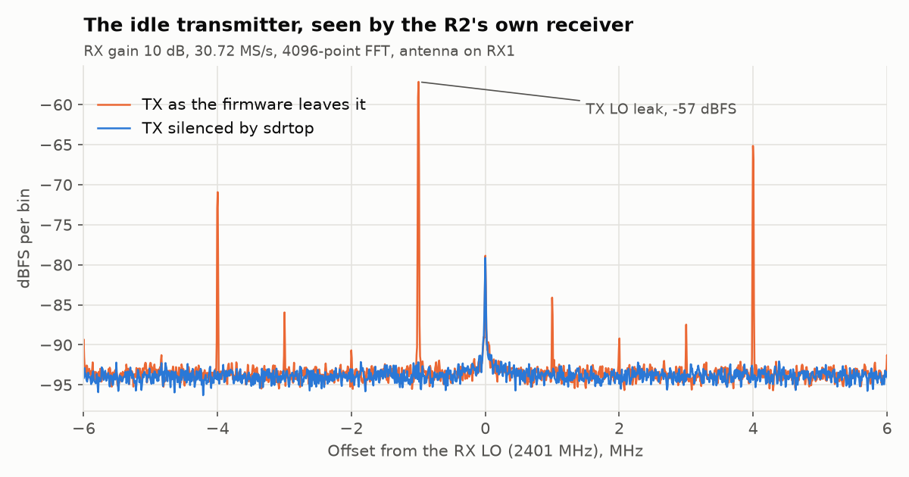
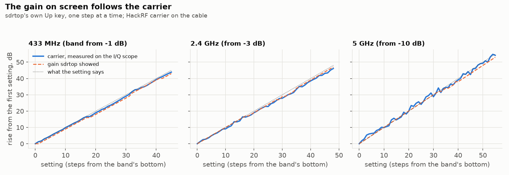
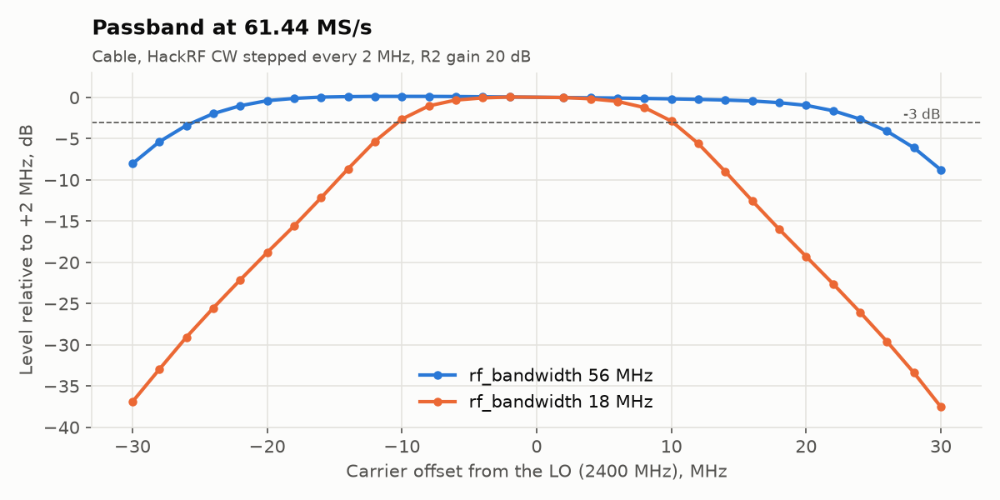

# PlutoSky R2, measured

← [PlutoSky R2](plutosky-r2.md)

---

This is what I measured on my PlutoSky R2 in November 2026. There are a lot
of PlutoSDR-style boards around, and they are not the same radio, so first,
exactly which one this is:

| | |
|---|---|
| Board | PlutoSky R2, made by [OpenSourceSDRLab](https://opensourcesdrlab.com/) |
| Calls itself | `Analog Devices PlutoSDR Rev.C (Z7020-AD9361)`, variant 1 |
| Firmware | `v0.38-5-g76414-dirty`, Linux 5.15.0, iiod 0.25 |
| Chips | Zynq 7020, and a transceiver that reports itself as an AD9361 |
| USB | `0456:b673`, named `PlutoSDR (ADALM-PLUTO)`, USB 2.0 |
| Port | RX1 |

It is not Analog Devices' ADALM-PLUTO, even though it borrows its name. It
runs a build of Analog Devices' Pluto firmware, and the names come from there.
None of this applies to the ADALM-PLUTO, the Pluto+, other OpenSourceSDRLab
boards, or this board on other firmware.

Is the chip really an AD9361, and not the cheaper AD9363? It behaves like one
everywhere the two differ: the full gain range and good image rejection at
71 MHz and at 5.8 GHz, both outside the AD9363's 325 to 3800 MHz, and a
passband 50 MHz wide, where the AD9363 stops at 20. That fits an AD9361, but
it doesn't prove it. The two are the same die, sorted at the factory.

The signal came from a HackRF One r10 (inside a PortaPack H4M, in HackRF mode)
on an SMA cable into RX1, never more than about -42 dBm. The AD9361 takes
+2.5 dBm, so there was plenty of room.

**Contents:** [The idle transmitter](#the-idle-transmitter) ·
[Gain](#gain) · [Filter and image](#filter-and-image) ·
[The link](#the-link) · [Timing](#timing) ·
[Against SoapySDR](#against-the-generic-soapysdr-path) ·
[Not measured](#not-measured)

## The idle transmitter

The AD9361 receives and transmits at the same time. After power-up the R2's
transmitter sends nothing, but its LO keeps running, and a running LO leaks.

| RX gain | Transmitter as after power-up | Transmitter silenced |
|---|---|---|
| 10 dB | -56.5 dBFS | about -102 dBFS (only the noise) |
| 40 dB | -27.0 dBFS | about -75 dBFS (only the noise) |

Tune the receiver to the same 2.4 GHz and the leak lands right at 0 Hz and
fills the converter. That's why sdrtop powers the transmitter down when it
opens the radio ([how](plutosky-r2.md#the-transmitter)).

## Gain

A gain setting on the AD9361 is really a row in a table, and each row sets
several amplifiers at once. So one step of the setting isn't always one
decibel. I measured every step, back to back against the same carrier, at 25
frequencies: 1,835 steps in all.

On average a step is 0.92 to 1.00 dB. The odd ones, the stripes in the chart,
sit at the same settings in every band, where the table switches an
amplifier in or out.

Added up, the real gain ends up between 5.6 dB under and 2.3 dB over what the
setting says. The worst is at 71 MHz, the very bottom of the range. Inside a
band it drifts smoothly with frequency, and a second run agreed with the first
to 0.04 dB a step. These measured figures are what sdrtop shows as the gain.

Then I checked it from the screen: a carrier on the cable, and the gain
stepped with sdrtop's own key, in each band.

| Band | Settings | The carrier moved | sdrtop showed | The setting said |
|---|---|---|---|---|
| 433 MHz | 45 | 43.9 dB | 43 dB | 45 dB |
| 2.4 GHz | 48 | 46.1 dB | 47 dB | 48 dB |
| 5 GHz | 55 | 54.2 dB | 53 dB | 55 dB |

What's left over is the screen rounding to whole decibels.

The AGC, in slow and in fast attack, held a carrier at about -8 to -12 dBFS and
went no higher than 64 dB. The hybrid mode didn't follow the signal at all, so
sdrtop doesn't offer it.

## Filter and image

| Filter setting | Width at -3 dB |
|---|---|
| 56 MHz | 50.0 MHz |
| 18 MHz | 20.4 MHz |

At the widest setting it stays flat within 1 dB over ±18 MHz. The image sits 50
to 60 dB down across the passband, with the chip's own tracking doing its job.

## The link

The radio samples at up to 61.44 Msps, but its USB network carries about 5.7.
sdrtop only offers the rates I ran without losing a sample: 2.083, 3 and 4
Msps. Talking to the radio straight over USB, without the network, gets to 7.8,
and that's the end of the road for USB 2.0. Ethernet I haven't measured yet.

## Timing

| Rate | Run | Lost samples | Clock against the PC |
|---|---|---|---|
| 3 Msps | ten minutes | 0 | +6 ppm |
| 4 Msps | ten minutes | 0 | -2 to +8 ppm |

When I pulled the cable, the stream stopped within two seconds and the screen
said why.

## Against the generic SoapySDR path

The same radio at 433 MHz and 3 Msps, a carrier 500 kHz off. The gains and the
links weren't the same, so read this as a feel rather than a fair fight.

| | SoapySDR | Native |
|---|---|---|
| Image rejection | 39.6 dB (the noise got in the way) | 65.3 dB |
| Quadrature | +0.02 dB, -1.15° | +0.00 dB, -0.00° |
| Read jitter | ±9.1 ms | ±0.2 ms |
| Gain on screen | One range for every band | Measured, per band |

## Not measured

- **6 GHz.** The HackRF is too weak up there, even with its amplifier on. So
  is my budget for a proper signal generator. sdrtop uses the 5.8 GHz table up
  to 6 GHz.
- **2.4 GHz above 66 dB.** The carrier was still too strong to measure, so the
  gain stops there.
- **Ethernet.** Waiting for a cable.
- **RSSI and the temperatures.** The chip's RSSI reads as a loss, not a level,
  and I had nothing calibrated to tie it to dBm.

---

← [PlutoSky R2](plutosky-r2.md)
