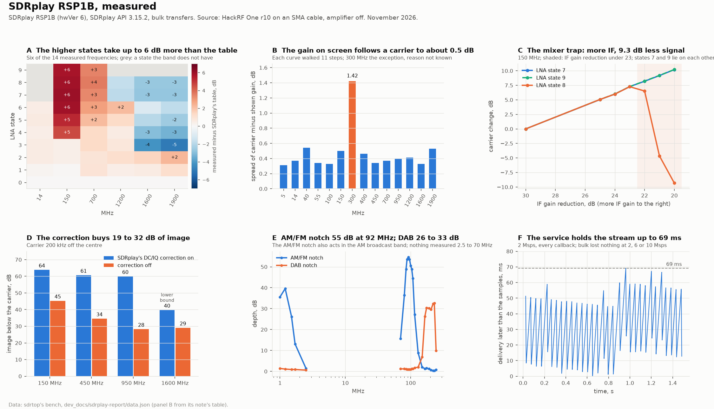
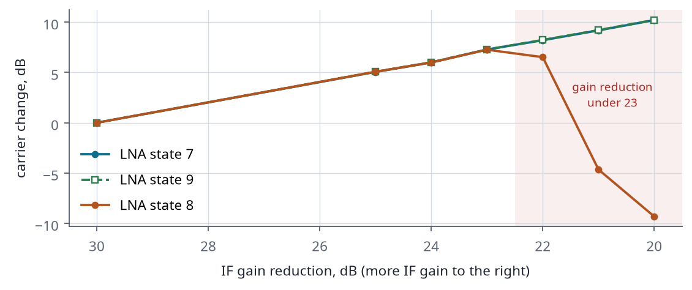
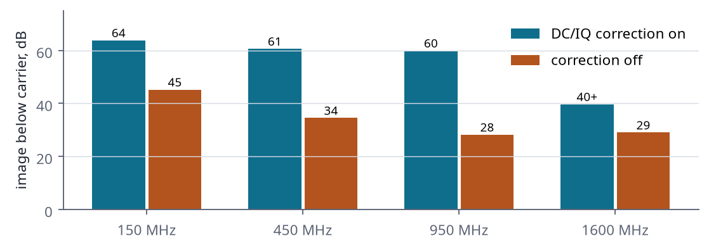
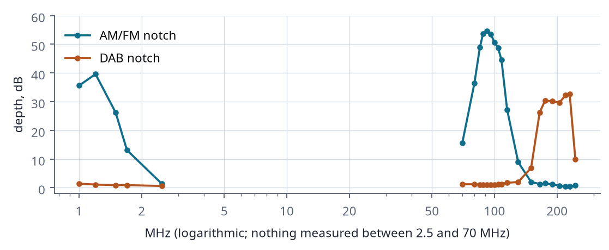

# SDRplay RSP1B, measured

← [SDRplay RSP1B](sdrplay.md)

---

This is what I measured on my RSP1B in November 2026:

| | |
|---|---|
| Radio | SDRplay RSP1B, made by [SDRplay](https://www.sdrplay.com/) |
| Hardware version | 6 (as the API reports it) |
| API | SDRplay API 3.15.2 with its service, bulk transfers |
| USB | `1df7:3050` |

It's about this RSP1B only, not the RSP1, the RSP1A or any other RSP.

The signal came from a HackRF One r10 (inside a PortaPack H4M, in HackRF mode,
firmware `n_261015`) on a short SMA cable straight into the antenna input, its
amplifier off, no attenuator. The RSP1B's bias tee was off, and I read that
back before every start. The HackRF is steady but not calibrated, so every
result here is a difference or a ratio. Levels are dBFS of the 16-bit words at
their full scale of 32768.

**Contents:** [LNA states](#the-lna-states) · [Gain on screen](#the-gain-on-screen) ·
[The mixer trap](#the-mixer-trap) · [Noise at the top](#noise-at-the-top) ·
[Image](#image-and-the-correction) · [Notches](#notches) · [Overload](#overload) ·
[Sample depth](#sample-depth) · [Delivery](#delivery-through-the-service) ·
[Against SoapySDR](#against-the-generic-soapysdr-path) · [Not measured](#not-measured)

## The LNA states

I measured how much each LNA state takes away, on a carrier, at 14
frequencies from 5 MHz to 1.9 GHz, and put it next to the table in SDRplay's
documentation.

Under 50 MHz my radio agrees with the table to about half a dB. Between 50 MHz
and 1 GHz the higher states take 1 to 6 dB more than listed: at 150 MHz,
state 7 takes 44.0 dB where the table says 38. In L-band the table even
changes shape with frequency, with state 3 taking 20.8 dB at 1200 MHz and 15.8
at 1600. The IF was the same everywhere: 39 dB, about 1 dB a step, with every
sixth step 1.25. So sdrtop carries its own measured table for each band.

## The gain on screen

I walked each gain curve one step at a time with a carrier on the cable. If the
gain on screen is right, the carrier minus the shown gain doesn't move. The
bars show how far it wandered over 11 steps.

0.3 to 0.55 dB at 13 of the 14 frequencies. 300 MHz is the odd one out at 1.1
to 1.4 dB, every time: inside LNA state 8 the IF steps there rise 0.4 to
0.7 dB less than anywhere else. I don't know why yet. It's on the list, right
under "buy an attenuator".

## The mixer trap

Some LNA states bring the mixer's gain reduction in with them. In those
states, once the IF gain reduction drops under 23 dB, more IF gain gives you
less signal. At 150 MHz, state 8 is 9.3 dB down at 20. I stepped every state
from 30 to 20 dB in four bands, and it showed up in states 4 and 6 under
50 MHz, state 8 from 50 to 420 MHz and in L-band, and state 9 from 420 MHz to
1 GHz, by as much as 14 dB. Never at 23 dB or above. Left alone at state 8,
SDRplay's AGC settled 5 to 10 dB short of where it was aiming. That's where
sdrtop's one rule for all bands comes from ([the rule](sdrplay.md#the-mixer-trap)).

## Noise at the top

With nothing on the antenna input, LNA state 0 sits near -2 dBFS rms once the
gain reduction is under 35 dB. The radio clips on its own noise there, and no
signal can measure a gain in that corner. At the same total gain, the
Sensitivity curve showed 15 dB less of the radio's own noise than Linearity.

## Image and the correction

A carrier 200 kHz off the centre, and its mirror image measured underneath:

At 1600 MHz the corrected image disappeared into the noise, so 40 dB is only
how far I could see. This is why SDRplay's correction is on by default in
sdrtop.

## Notches

The AM/FM notch reaches 55 dB at 92 MHz, and it works in the AM broadcast band
too (40 dB at 1.2 MHz). The DAB notch takes 26 to 33 dB from 165 to 230 MHz.

## Overload

The radio's own overload flag came on at an ADC peak of -12 dBFS, at 51.4 dB of
total gain. sdrtop shows the flag next to its own ADC reading, and the two
agree.

## Sample depth

Read from the stream with the correction off. With it on, the values step by 1
at every rate.

| Sample rate | Step of the sample values | Bits carried |
|---|---|---|
| 2 to 6 Msps | 4 | 14 |
| 6.048 to 9 Msps | 16 | 12 |
| 9.216 to 10 Msps | 256 | 8 |

The datasheet gives 10 bits from 8.064 to 9.216 MHz. My radio steps like 12
bits there. The API takes rates up to 10 MHz, where the datasheet mentions
10.66.

## Delivery through the service

I timed every callback against the earliest moment its samples could have
existed. The service holds on to the stream for up to about 70 ms (69 here),
then hands it all over in quick succession. That's fine for receiving, but it
is why sdrtop's timing bench shows how long the service held the stream
instead of grading deadlines.

With SDRplay's default isochronous transfers, seven runs of quarter-blocks
went missing in four minutes at 6 Msps. Bulk transfers lost nothing at 2, 6 or
10 Msps, for the same CPU, so sdrtop uses bulk.

| CPU, % of one i3 core, bulk | 2 Msps | 6 Msps | 10 Msps |
|---|---|---|---|
| SDRplay's service | 13.1 | 34.3 | 46.8 |
| A minimal program reading the stream | 3.3 | 8.9 | 8.3 |

## Against the generic SoapySDR path

The same radio at 150 MHz and 2 Msps, band noise only, half a minute on each
Lab view, once through SoapySDRPlay3 and once natively:

| | SoapySDR | Native |
|---|---|---|
| Gain on screen | `RF 9 dB`, an LNA state number read as decibels | `LNA 7 · IF 18   42 dB`, from the measured tables |
| Converter | 16-bit | 14-bit, as the radio delivers at 2 Msps, with its overload flag |
| DC under the noise | 34 dB | 33 dB |
| Timing | -1046 ppm, `POOR` | -11 ppm, `EXCELLENT`, the service holding up to 53 ms |

The SoapySDR clock figure was the timing bench misreading a pull stream. I've
fixed that since, for every SoapySDR radio, but I haven't measured this one
again.

## Not measured

- **Absolute levels.** The HackRF isn't calibrated.
- **Anything near the HackRF's own floor.** At 5 MHz, and for the corrected
  image at 1.6 GHz, the figures are lower bounds.
- **Where the 300 MHz oddity comes from.** It may be my bench, not the radio.
- **macOS.** Written, not yet tried with a radio.

---

← [SDRplay RSP1B](sdrplay.md)
