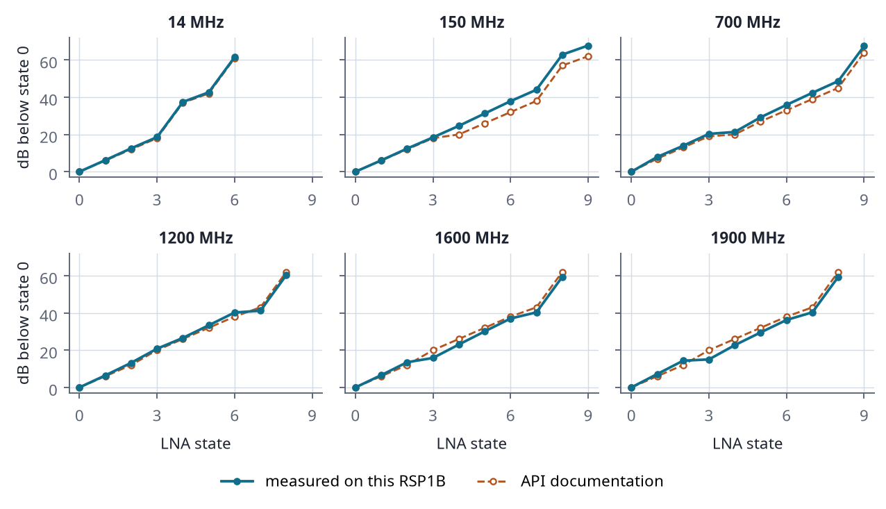
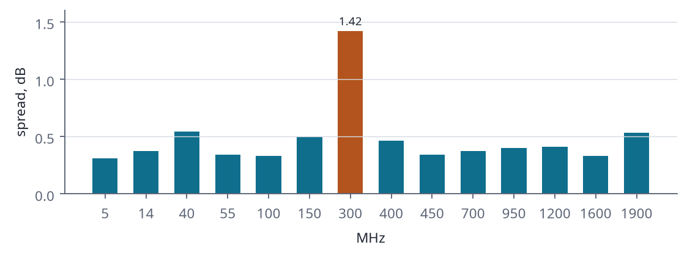
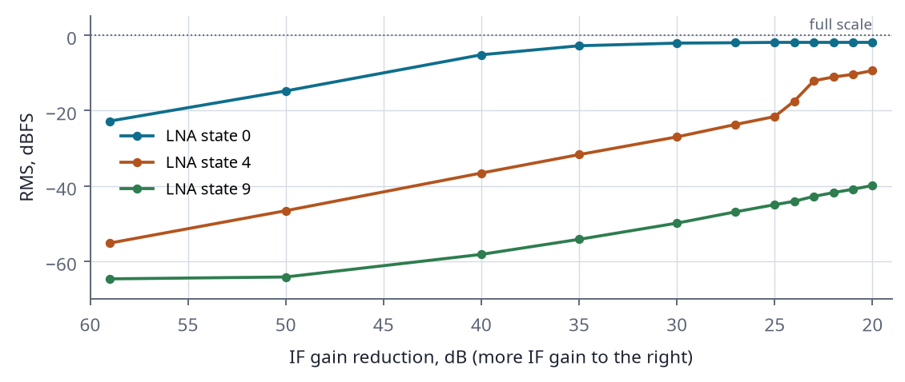
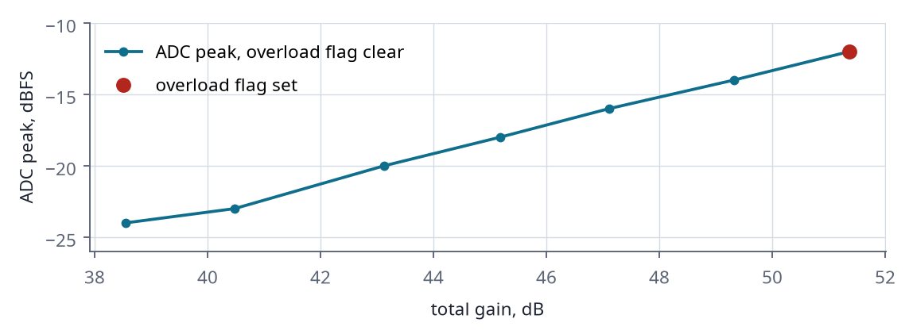
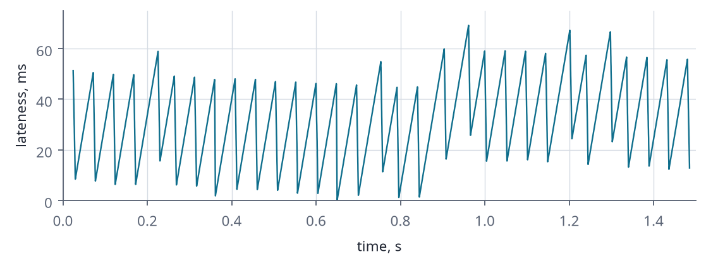
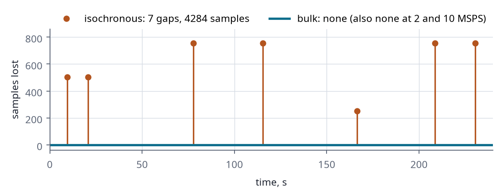

# SDRplay RSP1B, measured

← [SDRplay RSP1B](sdrplay.md)

---

What sdrtop's bench found on one RSP1B, in November 2026:

| | |
|---|---|
| Product | **SDRplay RSP1B**, made by [SDRplay](https://www.sdrplay.com/) |
| It reports itself as | hardware version 6 (`hwVer`) |
| API | SDRplay API 3.15.2 with its service, bulk transfers |
| USB | `1df7:3050` |

Not covered by this page: the RSP1, the RSP1A, or any other RSP.

The signal source was a **HackRF One r10** (inside a PortaPack H4M, in HackRF
mode, firmware `n_261015`) on a short SMA cable into the antenna input, its
amplifier off, no attenuator, the RSP1B's bias tee off and read back before
every start. The HackRF is steady but not calibrated, so every result is a
ratio. Levels are dBFS of the 16-bit words at their full scale of 32768.

**Contents:** [LNA states](#the-lna-states) · [Gain on screen](#the-gain-on-screen) ·
[The mixer trap](#the-mixer-trap) · [Noise at the top](#noise-at-the-top) ·
[Image](#image-and-the-correction) · [Notches](#notches) · [Overload](#overload) ·
[Sample depth](#sample-depth) · [Delivery](#delivery-through-the-service) ·
[Against SoapySDR](#against-the-generic-soapysdr-path) · [Not measured](#not-measured)

## The LNA states

Every LNA state's gain reduction was measured on a carrier at 14 frequencies
from 5 MHz to 1.9 GHz, and set beside the table in SDRplay's documentation.

| Band | Against the documented table |
|---|---|
| Under 50 MHz | agrees to about half a dB |
| 50 MHz to 1 GHz | the higher states take 1 to 6 dB more (150 MHz, state 7: 44.0 dB against 38) |
| L-band | the table's shape changes with frequency (state 3: 20.8 dB at 1200 MHz, 15.8 at 1600) |

The IF was the same everywhere: 39 dB, about 1 dB a step, every sixth step
1.25 dB. So sdrtop carries one measured table per band.

## The gain on screen

Each gain curve walked a step at a time against a carrier: the carrier minus
the gain sdrtop shows should not move. The bars are its largest spread over 11
steps.

0.3 to 0.55 dB at 13 of the 14 frequencies. **300 MHz is the exception**, 1.1
to 1.4 dB, repeatably: inside LNA state 8 the IF steps there rise 0.4 to 0.7 dB
less than elsewhere. The reason is not known.

## The mixer trap

In the LNA states that bring a mixer gain reduction with them, once the IF
gain reduction goes under 23 dB, more IF gain gives *less* signal: at 150 MHz,
state 8 is 9.3 dB down at 20. Stepped from 30 to 20 dB in four bands, it
appeared in states 4 and 6 under 50 MHz, state 8 from 50 to 420 MHz and in
L-band, and state 9 from 420 MHz to 1 GHz, by up to 14 dB; never at 23 dB or
more. Left to itself at state 8, SDRplay's AGC settled 5 to 10 dB short of its
set point. This is where sdrtop's one rule for all bands comes from
([the rule](sdrplay.md#the-mixer-trap)).

## Noise at the top

With nothing on the antenna input, LNA state 0 sits near -2 dBFS rms from a
gain reduction of 35 dB down: the radio clips on its own noise, and no signal
can measure a gain there. At the same total gain, the Sensitivity curve showed
15 dB less of the radio's own noise than Linearity.

## Image and the correction

A carrier 200 kHz off the centre, its mirror image measured below it:

At 1600 MHz the corrected image was under the noise floor, so 40 dB is a lower
bound. This is why SDRplay's correction is on by default in sdrtop.

## Notches

The AM/FM notch reaches 55 dB at 92 MHz and acts in the AM broadcast band too
(40 dB at 1.2 MHz). The DAB notch takes 26 to 33 dB from 165 to 230 MHz.

## Overload

The radio's own overload flag came on at an ADC peak of -12 dBFS, at 51.4 dB
of total gain. sdrtop shows the flag beside its own ADC reading, and the two
agree.

## Sample depth

Read from the stream with the correction off (with it on, the values step by 1
at every rate):

| Sample rate | Step of the sample values | Bits carried |
|---|---|---|
| 2 to 6 Msps | 4 | 14 |
| 6.048 to 9 Msps | 16 | 12 |
| 9.216 to 10 Msps | 256 | 8 |

The datasheet gives 10 bits from 8.064 to 9.216 MHz; this unit steps as
12-bit there. The API takes rates up to 10 MHz, where the datasheet mentions
10.66.

## Delivery through the service

Every callback timed against the earliest moment its samples could have
existed: the service holds the stream for up to about 70 ms (69 ms here) and
then delivers it in quick succession. Fine for receiving; it is why the timing
bench shows how long the service held the stream instead of grading
deadlines.

Isochronous transfers, SDRplay's default, lost seven runs of quarter-blocks in
four minutes at 6 Msps; bulk lost nothing at 2, 6 or 10 Msps, at the same CPU
cost. sdrtop uses bulk.

| CPU, % of one i3 core, bulk | 2 Msps | 6 Msps | 10 Msps |
|---|---|---|---|
| SDRplay's service | 13.1 | 34.3 | 46.8 |
| A minimal client reading the stream | 3.3 | 8.9 | 8.3 |

## Against the generic SoapySDR path

The same radio at 150 MHz, 2 Msps, band noise only, 30 seconds per Lab view,
through SoapySDRPlay3 and natively:

| | SoapySDR | Native |
|---|---|---|
| Gain on screen | `RF 9 dB`: an LNA state number read as dB | `LNA 7 · IF 18   42 dB`, from the measured tables |
| Converter | 16-bit | 14-bit, as the radio delivers at 2 Msps, with its overload flag |
| DC under the noise | 34 dB | 33 dB |
| Timing | -1046 ppm, `POOR` | -11 ppm, `EXCELLENT`, held ≤ 53 ms by the service |

The SoapySDR clock figure came from the timing bench reading a pull stream
from its latest deliveries; that reading has since been corrected for every
SoapySDR radio, but this one was not measured again.

## Not measured

- **Absolute levels:** the HackRF is not calibrated.
- **Near the HackRF's own floor** (5 MHz, the corrected image at 1.6 GHz) the
  results are lower bounds.
- **The 300 MHz deviation** may come from the bench rather than the radio.
- **macOS:** written, not yet run with a radio.

---

← [SDRplay RSP1B](sdrplay.md)
