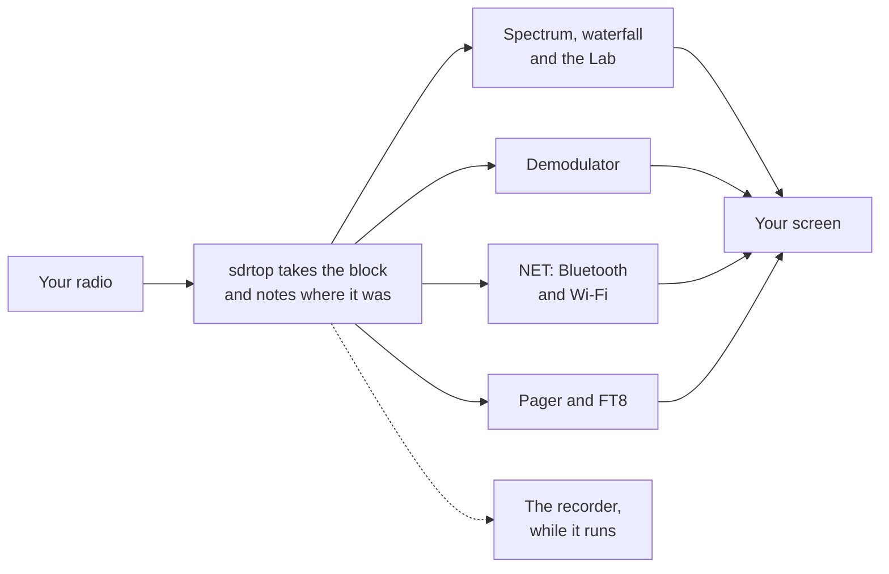
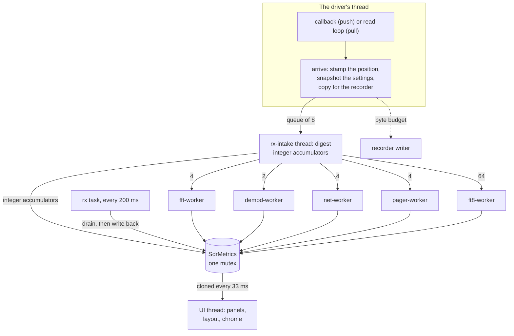

# From the antenna to the screen

← [Back](README.md)

---

This page is about what happens to your samples between the radio and the
numbers on screen. The first half is for anyone curious. The second half is
for people who read source code for fun, and it says so at the door.

(The diagrams are drawn by GitHub. In a terminal you'll see their source,
which is readable too, just less pretty.)

## The short version



The radio hands over its samples in blocks. sdrtop writes down where in the
stream each block belongs, copies it, and lets the radio get on with its life.
Everything else happens on other threads, after the radio has already moved
on.

That last part matters more than it sounds. sdrtop used to do its work right
there on the radio's own thread, and at 20 Msps a HackRF quietly lost a third
of its samples inside the radio, where nobody could see it, while everything
on screen looked perfectly fine. I found out the embarrassing way. Now the
radio's thread never waits for sdrtop, on every radio that sends samples.

From there the block goes to whichever parts of sdrtop need it, and only to
those. If no view on screen reads the spectrum, the spectrum isn't computed.
If you aren't looking at the NET section, the Bluetooth decoders sit idle.
Your CPU has better things to do than draw a waterfall you can't see.

## When something gets lost

Every queue in that picture is short on purpose. When sdrtop falls behind, it
drops a block rather than make the radio wait, because a dropped block is a
known hole, and a radio that waits loses samples where no one can count them.

Samples lost from the stream are counted, at the place where they went
missing, and the timing bench tells you whose loss it was: `Lost: driver N ·
sdrtop M`, the radio's driver or sdrtop itself. A panel whose numbers cover a
stretch where its feed dropped blocks says `[FEED LOSS]`, because its counts
are then only lower bounds. The recorder knows to the sample where its file
has a hole, and why. A loss that is counted is a fact. A loss that isn't is a
lie with good manners.

## How often the numbers change

| What | How often |
|---|---|
| The screen redraws | about 30 times a second |
| The spectrum and waterfall | about 30 times a second |
| The radio and signal figures (levels, timing, I/Q) | every 200 ms |
| The demodulator's measurements | 4 times a second |

The statistics behind the figures are counted on every single sample, in
whole numbers, as the blocks arrive. Every 200 ms they are turned into the
decibels and degrees you read. So a figure on screen covers all the samples
since the last one, not a lucky sample picked from somewhere.

When a panel's data stops being live, say the stream stopped, the panel says
`[STALE]` and its frame changes colour, after half a second on a radio that
sends samples (a tinySA's slow sweeps get five). It won't show you an old
number as if it were new.

## What the corrections change, and what they don't

If you switch on DC blocking (`D`) or the I/Q calibration (`C`), the spectrum,
the demodulator and the constellation see the corrected samples, so you can
watch the correction work. The statistics underneath still come from what the
radio actually delivered, because a correction has to be built from the real
thing. What the I/Q bench prints is what the correction left over.

## The tinySA is different

A tinySA doesn't send samples at all. It sends finished power readings in dBm,
and runs its own sweeps. So it takes a separate, much simpler road to the
screen, and the views that need raw samples tell you they can't work with it.

## If you are a nerd

Welcome. Here is the same picture with the thread names and the queue depths
in it, as they are in the source today.



**The driver's thread does almost nothing.** `arrive` takes one short lock, one
atomic add, and a copy only while a recording runs, then the block goes into
an eight-deep queue to the `rx-intake` thread. Eight blocks is about 50 ms of a
HackRF at 20 Msps, twice the longest stall measured on the callback. Every
native backend and SoapySDR go through this same door, whether the driver
calls us (push) or we call the driver (pull). Why it is built this way is
written at the top of
[`src/hardware/intake.rs`](../src/hardware/intake.rs).

**The feeds are bounded and lossy, each for its own reason.** The demod's is
two deep, because it only updates four times a second and anything deeper
would hold blocks it is going to throw away. NET and the pager are four deep
because they want every block, and a deeper queue would start hiding losses
instead of absorbing them. FT8 is 64 deep, because nothing there is in a hurry
and a stall of the whole machine mustn't cost a 15-second cycle. Blocks carry
their stream position, so a worker can tell a gap from a pause, and NET
rebuilds its receivers at every break. The comments in
[`src/app/builder/mod.rs`](../src/app/builder/mod.rs) say this better than I
can here.

**The 200 ms loop is split by when it holds the lock.** The UI thread clones
the whole state under the same mutex on every frame, so a float computed while
holding it is a dropped frame, and a device call while holding it is a visible
stall:

```text
poll::drain          lock      integer work only
metrics::*           no lock   every sqrt, log10, asin
publish::write_back  lock      write the results
control::*           no lock   talk to the radio
```

The details live in [`src/tasks/rx/mod.rs`](../src/tasks/rx/mod.rs).

**The FFT worker is split the same way**: `frame` (per-frame DSP, full rate, no
lock), `analysis` (the measurements, display rate, no lock, no clock),
`readout`, then `publish`, the one lock block
([`src/signal/fft/mod.rs`](../src/signal/fft/mod.rs)).

**The NET worker is one thread that owns its state**, and within one block it
runs the BLE receiver and every classic Bluetooth channel's receiver side by
side on scoped threads, then puts the answers back in the order one thread
would have produced them. Same results, bit for bit, in less time
([`src/signal/net/worker/mod.rs`](../src/signal/net/worker/mod.rs)).

**The demodulator measures, it doesn't play.** There is no audio. It reports
the physics (deviation, pilot, CTCSS tone, AM depth), with its work capped at
65,536 input pairs per update and four updates a second, so its cost doesn't
grow with the sample rate. Narrow-band FM is the exception and pays for every
block, because its CTCSS tones sit about 2 Hz apart, and telling them apart
takes half a second of unbroken audio
([`src/signal/demod/mod.rs`](../src/signal/demod/mod.rs)).

**Two rules hold everywhere.** A poisoned mutex never takes the screen down
with it: every lock recovers the data and carries on. And no panel decides for
itself whether its data is stale: it declares what its data depends on, and
the frame code marks it, against the one threshold the radio declares
([`src/ui/panel.rs`](../src/ui/panel.rs)).

If any of this disagrees with the code, the code wins, and I'd like to know.
Most modules open with a comment that explains why they are split the way they
are. That's where the real reasoning is. This page is just the map.

---

← [Back](README.md)
